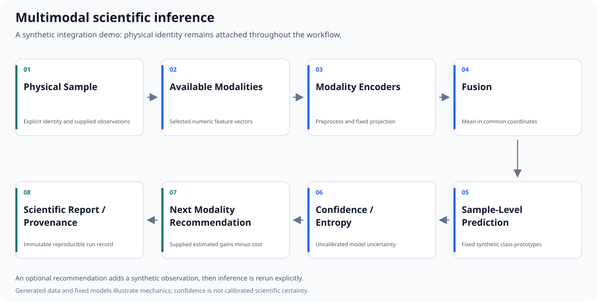

# Multimodal Inference Demo

[](https://github.com/vagelisNerantzis/multimodal-inference-demo/actions/workflows/tests.yml)

A compact, NumPy-only demonstration of physical-sample-level multimodal
inference: generated observations, fixed encoders, fusion, classification,
uncertainty, an optional acquisition recommendation, and a reproducible report.
Version **0.1.0**.

## Purpose and portfolio role

This repository is the integration/demo layer of a scientific multimodal ML
portfolio. It makes the boundaries between sample identity, representations,
decisions and provenance visible in a small runnable example. It connects
conceptually to leakage-safe benchmarking, multimodal representation learning
and adaptive modality acquisition, while installing independently of those
repositories.

**All bundled data are synthetic.** No private dataset, real textile result,
pretrained network, checkpoint or external service is needed. Textiles are only
one motivating scientific use case; the interfaces are domain-independent.

## End-to-end architecture

```text
physical sample -> supplied modality observations -> deterministic encoders
    -> mean fusion -> sample classifier -> confidence / entropy
    -> optional next-modality recommendation -> report / provenance
```



The [SVG generator](assets/generate_workflow.py) uses only the Python standard
library and regenerates the version-controlled figure byte-for-byte.

## Features

- Explicit physical IDs, observation identities and modality availability.
- Seeded numeric feature generation with modality-specific noise and scales.
- Separate fixed projections into a common embedding dimension.
- Deterministic mean embedding fusion with canonical modality ordering.
- Fixed prototype classification with normalized probabilities.
- Natural-log entropy and maximum-probability confidence.
- A small recommendation adapter using supplied estimated gains and costs.
- Immutable inference/provenance snapshots and deterministic serialization.
- Separate human-readable reporting, synthetic CPU tests and minimal CI.

## Installation

Use Python 3.10+ and a new environment:

```bash
python -m pip install -e ".[dev]"
```

NumPy is the only runtime dependency. pytest is a development extra. There are
no local path dependencies on the other portfolio repositories, and no GPU,
PyTorch, notebook or model download is required. YAML is illustrative, not a
required runtime dependency.

## Run the demo

```bash
python examples/run_demo.py
```

The example generates one sample cohort, selects a physical sample, infers from
an initial modality subset, prints its uncertainty, obtains a recommendation,
adds the recommended synthetic observation and reruns inference. It prints the
final text report and deterministic provenance. The initial and final values
are constructed demonstrations, not held-out performance estimates.

Example output has this structure; placeholders below are schematic:

```text
Sample: synthetic_000
Modalities used: macro
Prediction: class_<index>
Confidence: <computed probability>
Entropy: <computed nats>
Recommended next modality: <supplied-utility decision or None>
Reason: <selection or stopping explanation>
```

Actual executed results are recorded in [the validation report](docs/validation_report.md).

## Minimal Python usage

```python
from multimodal_inference_demo.data.synthetic import generate_samples
from multimodal_inference_demo.inference.pipeline import infer_sample
from multimodal_inference_demo.acquisition.recommend import recommend_next
from multimodal_inference_demo.reporting.report import format_report

sample = generate_samples(n_samples=1, seed=42)[0]
result = infer_sample(sample, modalities=["macro"])
remaining_gain = 1.0 - result.confidence
estimated_gains = {
    name: 0.9 * remaining_gain
    for name in sample.available_modalities
    if name not in result.modalities_used
}
costs = {name: spec.cost for name, spec in sample.modality_specs.items()}
recommendation = recommend_next(
    result, sample.available_modalities, estimated_gains, costs,
    cost_weight=0.02, confidence_threshold=0.90,
)
print(format_report(result, recommendation))
```

Estimated gains are supplied forecasts, not measurements of unacquired data.
The inference pipeline uses only selected observations. Ground-truth class
metadata is for evaluating constructed cases and is not used to predict.

## Testing and CI

```bash
python -m compileall src tests examples assets
pytest -q
python assets/generate_workflow.py
python assets/generate_workflow.py --check
```

CI runs on pushes and pull requests targeting `main`, using Python 3.12 on
Ubuntu. It installs development dependencies, compiles, runs tests and the
synthetic demo, verifies version consistency, and rejects a changed SVG after
regeneration. No application step needs network access after installation.
**Hosted CI is pending publication and its first successful run**; the badge
does not assert a hosted success. Actual local checks are documented separately.

## Reproducibility

Seeds are explicit; keyed deterministic random generators avoid dependence on
modality dictionary order or Python's randomized hash. No library call changes
the global NumPy random state. Encoders have deterministic identifiers and
inference canonicalizes modality ordering before fusion and provenance.

Provenance contains the sample ID, selected modalities, model/encoder IDs,
seed, package and NumPy versions, prediction, confidence, entropy, and input/run
digests. It records no machine directories and needs no wall-clock timestamp.
Changing the selected observations or model configuration changes the relevant
provenance; changing unacquired observations does not affect an inference run.
Determinism is defined for a fixed configuration and numerical stack; exact
cross-version or cross-platform floating-point equivalence is not promised.

## Repository structure

```text
src/multimodal_inference_demo/
  data/             generated numeric observations and physical sample records
  models/           fixed encoders and prototype classifier
  fusion/           canonical embedding mean
  inference/        high-level sample API and result
  uncertainty/      validated confidence and entropy
  acquisition/      small supplied-gain recommendation adapter
  provenance/       deterministic immutable inference records
  reporting/        human-readable report formatting
  validation/       shape, probability and identity contracts
tests/              synthetic CPU pytest suite
examples/run_demo.py
configs/example.yaml
docs/architecture.md
docs/portfolio_integration.md
docs/validation_report.md
assets/             deterministic SVG and its generator
.github/workflows/tests.yml
```

## Scope of v0.1.0 and limitations

This is a synthetic integration demonstration, not a reproduction of the other
repositories or a model-training system. Encoders undo deliberately known
synthetic transforms; prototypes are fixed, and no learning is claimed.
Configured class count must fit both the embedding and feature dimensions.

One numeric observation is supplied per modality/sample in this version.
Multiple images/crops per modality would require an additional aggregation
contract. Fixed prototype logits produce uncalibrated class probabilities;
confidence is not a scientific guarantee of correctness. Fusion can improve
confidence in deliberately controlled examples, but need not improve accuracy,
confidence or uncertainty for arbitrary noisy inputs.

The recommendation maximizes supplied estimated confidence gain minus weighted
cost, with deterministic lexical ties. It can stop on sufficient confidence,
no candidates or non-positive utility. It is not a learned router, a full
sequential-budget simulator, or a globally optimal policy. No test-set selection,
calibration, bootstrap intervals or leakage-proof split manager is included.

See [the architecture](docs/architecture.md) and
[portfolio boundaries](docs/portfolio_integration.md) for the precise contracts.

## License

[MIT](LICENSE) applies to the software. No rights to private datasets,
checkpoints or third-party scientific results are implied.
